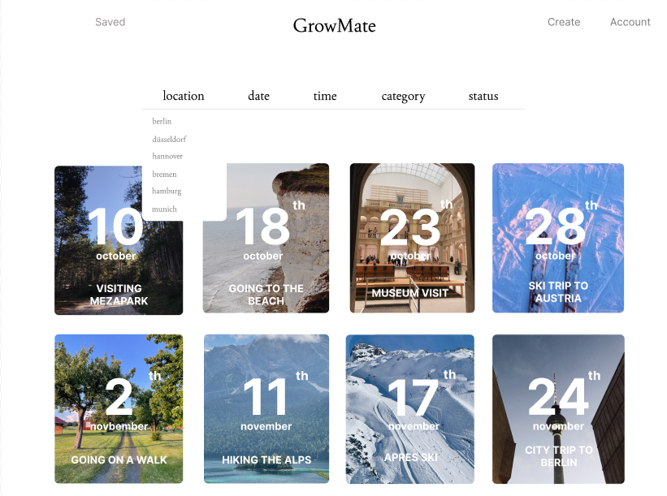
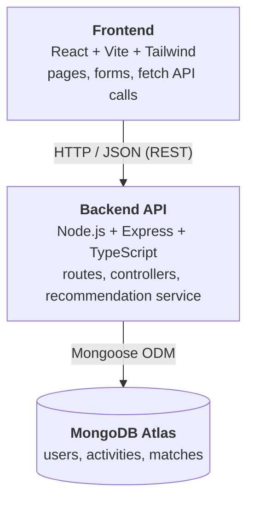
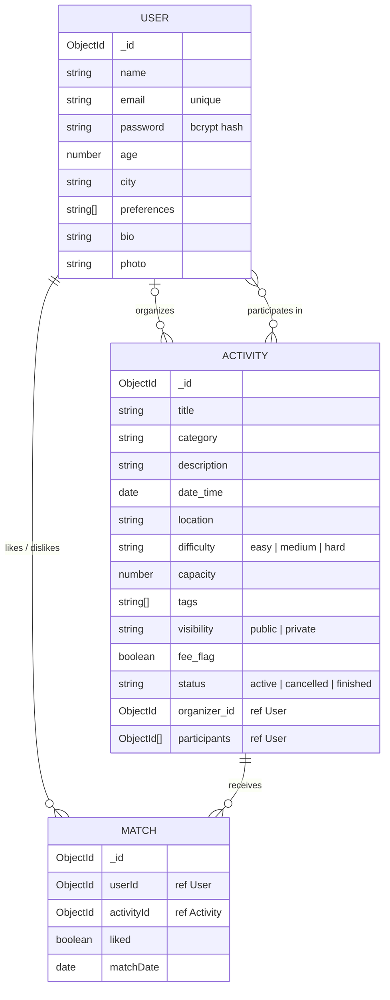

# GrowMate — Activity-based social matching

GrowMate is a full-stack web application that connects people through shared activities. Users sign up with their interests and city, discover activities (hiking, surfing, coffee meetups, gallery visits…), like or skip them in a swipe-style feed, save the ones they care about and create their own.

Built as a team project during my Erasmus exchange, in an international team of six students.


*Design mockup of the discovery page.*

## Features

- **Accounts:** sign up and log in, with passwords hashed using bcrypt.
- **Discovery feed:** browse activities and like or dislike them. Activities you have already seen are not shown again.
- **Recommendations:** activities are ranked by how well they match your interests and your city (see below).
- **Create activities:** set the category, tags, date, location, difficulty, capacity and visibility.
- **Saved and joined activities**, angit push github --tags activity detail page and a user account page.
- Informational pages: landing, About us, FAQ and Contact.

## Recommendation logic

Recommendations are computed with a **MongoDB aggregation pipeline** (`api-server/src/services/recommend.service.ts`):

1. Keep only active, public activities the user has **not** interacted with yet.
2. Normalise category and tags to lowercase so that matching is robust.
3. Score each activity:
   - `score_prefs` = 1 if the category matches the user's preferences, plus 1 for each matching tag.
   - `score_city` = 1 if the activity is in the user's city.
   - **`score = 3 · score_prefs + 2 · score_city`**, so interests weigh more than location.
4. Sort by score, using a random tiebreaker to keep the feed varied, and return the top *N*.

## Tech stack

| Layer    | Technologies |
|----------|--------------|
| Frontend | React 19, Vite, React Router, Tailwind CSS v4 |
| Backend  | Node.js, Express, TypeScript |
| Database | MongoDB (Atlas) with Mongoose (schemas, indexes, cascade deletes) |
| Auth     | bcrypt password hashing |

## Architecture & data model

The system follows a three-layer architecture:



**Data model (implemented).** Three collections: `users`, `activities` and `matches`. A match is the like/dislike of a user on an activity and works as a link collection for the many-to-many relation between users and activities. Documents reference each other by ID instead of duplicating data, while small lists such as preferences and tags are embedded.



Chat, join requests, ratings and reports were part of the original design but are not implemented yet.

## Project structure

```
growmate/
├── api-server/            # REST API (Express + TypeScript)
│   └── src/
│       ├── models/        # User, Activity, Match (likes) schemas
│       ├── controllers/   # Request handlers
│       ├── routes/        # /api/user, /api/activity, /api/match
│       ├── services/      # Recommendation engine
│       ├── db.ts          # MongoDB connection
│       └── app.ts         # Server entry point
└── client/                # React + Vite frontend
    └── src/
        ├── components/    # Pages and widgets
        ├── contexts/      # Auth and saved-activities state
        ├── router/        # App routes
        └── services/      # API calls
```

## API overview

| Method | Endpoint | Description |
|--------|----------|-------------|
| POST | `/api/user/signup` | Create an account |
| POST | `/api/user/login` | Log in |
| GET  | `/api/activity` | List activities |
| GET  | `/api/activity/:id` | Activity details |
| POST | `/api/activity/add` | Create an activity |
| GET  | `/api/match/discover` | Recommended activities for a user |
| POST | `/api/match/like` · `/dislike` · `/unlike` | React to an activity |
| GET  | `/api/match/likes` | A user's liked activities |

## Running locally

**Requirements:** Node.js 18+ and a MongoDB database (local or Atlas).

**1. Backend**
```bash
cd growmate/api-server
npm install
```
Create a `.env` file in `growmate/api-server/`:
```
MONGO_URI=your_mongodb_connection_string
PORT=3000
```
```bash
npm run dev        # http://localhost:3000
```

**2. Frontend** (in a second terminal)
```bash
cd growmate/client
npm install
npm run dev        # http://localhost:5173
```
The frontend calls `http://localhost:3000` by default. To use another API URL, set `VITE_API_URL`.


